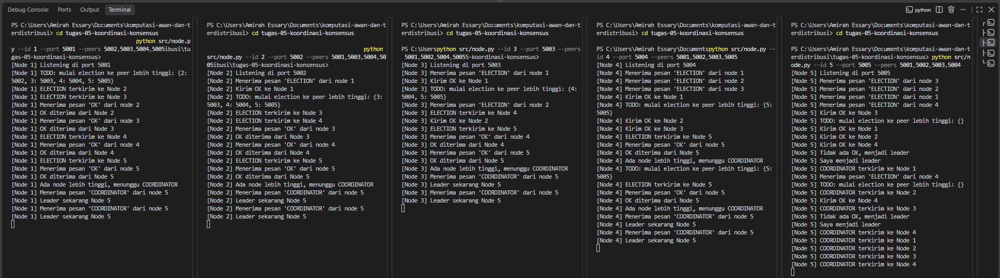
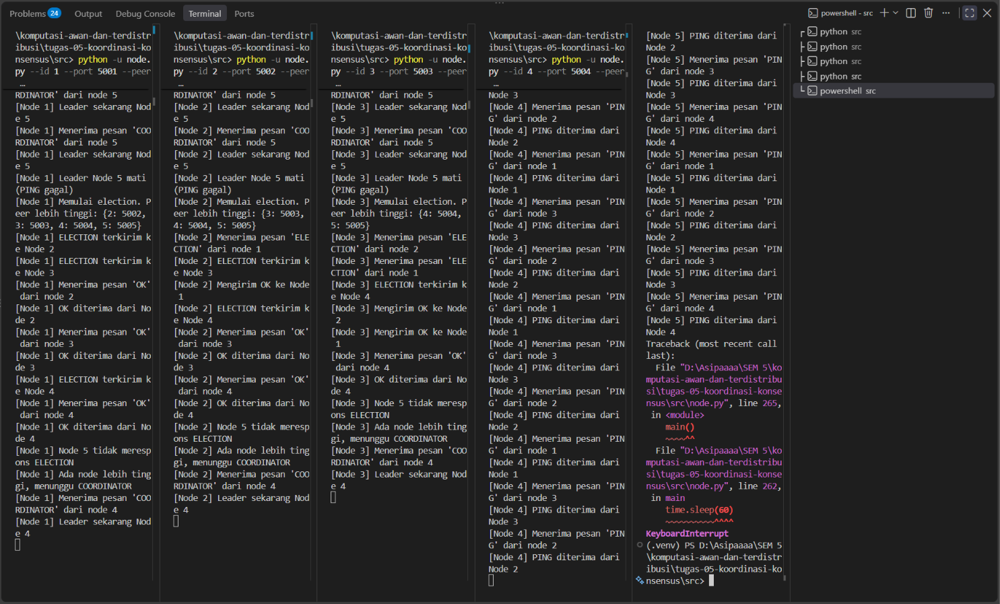

# Tugas 5 (Pekan 5) — Koordinasi & Konsensus

**Materi terkait:** Physical/Logical Clock, Election Algorithm (Bully/Raft).

# 1. Deskripsi Sistem dan Implementasi

Pada sistem terdistribusi, beberapa komputer atau server dapat bekerja secara bersamaan untuk menjalankan suatu layanan. Namun, ketika beberapa node melakukan proses secara bersamaan, dapat terjadi konflik keputusan apabila tidak terdapat pihak yang mengatur koordinasi. Pada studi kasus FoodGo, beberapa server dapat menerima dan mencatat pesanan dengan urutan berbeda akibat perbedaan waktu dan proses. Oleh karena itu, diperlukan sebuah **Node Leader** yang bertugas sebagai koordinator agar proses antrean pesanan tetap konsisten dan tidak terjadi pemrosesan ganda.

Pada tugas ini dilakukan implementasi **Bully Algorithm** untuk melakukan pemilihan leader pada 5 node virtual yang berjalan sebagai proses Python terpisah.

Komunikasi antar node menggunakan:
- TCP Socket
- Localhost
- Port berbeda untuk setiap node

Konfigurasi node yang digunakan:
- Node 1 : Port 5001
- Node 2 : Port 5002
- Node 3 : Port 5003
- Node 4 : Port 5004
- Node 5 : Port 5005

Pesan yang digunakan dalam komunikasi antar node:
- **ELECTION** : Digunakan untuk memulai proses pemilihan leader.
- **OK** : Digunakan sebagai respons bahwa node dengan ID lebih tinggi masih aktif.
- **COORDINATOR** : Digunakan untuk mengumumkan leader baru kepada seluruh node.
- **PING** : Digunakan untuk mengecek apakah leader masih aktif.

## Cara menjalankan program
Buka lima terminal terpisah di VS Code dari folder utama proyek. Jalankan satu perintah pada setiap terminal. Pada Windows PowerShell, gunakan python jika perintah tersebut tersedia di lingkungan Python yang digunakan.

Terminal 1:
python -u src/node.py --id 1 --port 5001 --peers 5002,5003,5004,5005

Terminal 2:
python -u src/node.py --id 2 --port 5002 --peers 5001,5003,5004,5005

Terminal 3:
python -u src/node.py --id 3 --port 5003 --peers 5001,5002,5004,5005

Terminal 4:
python -u src/node.py --id 4 --port 5004 --peers 5001,5002,5003,5005

Terminal 5:
python -u src/node.py --id 5 --port 5005 --peers 5001,5002,5003,5004

Jika perintah python tidak dikenali di Windows, coba py sebagai penggantinya. Pastikan semua node dijalankan dari folder utama proyek agar jalur src/node.py sesuai.

## Hubungan dengan Physical Clock dan Logical Clock

Physical clock mengacu pada waktu nyata yang ditunjukkan oleh jam perangkat. Jam pada server berbeda dapat tidak sinkron, sehingga timestamp dari setiap server belum tentu cukup untuk menentukan urutan kejadian secara konsisten.

Logical clock, seperti Lamport clock, membantu mengurutkan kejadian berdasarkan hubungan sebab-akibat antar-kejadian, bukan berdasarkan waktu kalender secara langsung.

Implementasi pada tugas ini berfokus pada pemilihan leader menggunakan Bully Algorithm. Program ini tidak mengimplementasikan sinkronisasi physical clock maupun logical clock. Leader dapat menjadi koordinator antrean, tetapi pemilihan leader saja tidak otomatis menjamin urutan pesanan atau mencegah pemrosesan ganda. Sistem FoodGo tetap memerlukan mekanisme tambahan, misalnya ID pesanan unik, pemeriksaan duplikasi, dan aturan penetapan urutan pesanan.
---

# 2. Implementasi Bully Algorithm

Bully Algorithm adalah algoritma pemilihan leader pada sistem terdistribusi yang memilih node dengan ID tertinggi sebagai leader. Cara kerja algoritma pada program:

1. Ketika sebuah node tidak menemukan leader, node tersebut mengirim pesan **ELECTION** kepada node lain yang memiliki ID lebih besar.
2. Jika terdapat node dengan ID lebih besar yang masih aktif, node tersebut mengirim pesan **OK** sebagai tanda bahwa masih ada kandidat dengan prioritas lebih tinggi.
3. Node yang menerima pesan **OK** akan berhenti mencalonkan diri dan menunggu pesan **COORDINATOR** dari node dengan ID tertinggi.
4. Jika tidak ada node dengan ID lebih tinggi yang merespons, maka node tersebut menjadi leader baru dan mengirim pesan **COORDINATOR** kepada seluruh node lainnya.

---
# 3. Mengapa Bully Algorithm Selalu Memilih Node Ber-ID Tertinggi yang Masih Hidup?

Bully Algorithm menggunakan konsep prioritas berdasarkan ID node. Setiap node memiliki ID unik yang digunakan sebagai penentu dalam proses pemilihan leader. Node dengan ID lebih besar memiliki prioritas lebih tinggi dibandingkan node dengan ID kecil. Pada simulasi ini terdapat lima node:

- Node 1
- Node 2
- Node 3
- Node 4
- Node 5

Node 5 memiliki ID terbesar sehingga memiliki prioritas tertinggi.Ketika sebuah node mendeteksi bahwa leader tidak aktif, node tersebut tidak langsung menjadi leader. Node tersebut terlebih dahulu mengirim pesan **ELECTION** kepada node lain yang memiliki ID lebih besar.

Contoh:
Jika Node 2 memulai proses election, maka Node 2 akan mengirim pesan **ELECTION** kepada:
- Node 3
- Node 4
- Node 5

Jika salah satu node tersebut masih aktif, maka node tersebut akan mengirim pesan **OK** kepada Node 2. Pesan **OK** menunjukkan bahwa masih terdapat node dengan prioritas lebih tinggi yang aktif, sehingga Node 2 harus berhenti mencalonkan diri dan menunggu keputusan dari node dengan ID lebih tinggi. Proses election akan terus berlangsung hingga ditemukan node dengan ID tertinggi yang masih hidup.

| Kondisi | Node Aktif | Hasil Election | Alasan |
|---|---|---|---|
| Kondisi normal | Node 1, Node 2, Node 3, Node 4, Node 5 | Leader = Node 5 | Node 5 memiliki ID tertinggi sehingga memiliki prioritas paling tinggi. |
| Node 5 mengalami kegagalan | Node 1, Node 2, Node 3, Node 4 | Leader baru = Node 4 | Node 4 memiliki ID tertinggi dari node yang masih aktif. |

Dengan mekanisme tersebut, Bully Algorithm mampu menentukan leader secara otomatis dan memastikan seluruh node memiliki keputusan yang sama mengenai leader yang sedang aktif.

# 4. Mengapa Sistem Membutuhkan Leader?

Leader diperlukan dalam sistem terdistribusi untuk menjaga koordinasi antar node. Tanpa adanya leader, setiap node dapat mengambil keputusan sendiri sehingga dapat menyebabkan:

- Konflik pemrosesan data.
- Perbedaan urutan transaksi.
- Pemrosesan data secara ganda.
- Ketidakkonsistenan informasi.

Pada kasus FoodGo, leader berfungsi sebagai pusat koordinasi antrean pesanan sehingga seluruh server memiliki acuan yang sama dalam memproses pesanan. Namun, pemilihan leader saja belum menjamin konsistensi seluruh data pesanan, masih diperlukan aturan pemrosesan pesanan dan pencegahan duplikasi.

---

# 5. Kelemahan Bully Algorithm Dibanding Algoritma Lain

Walaupun Bully Algorithm sederhana dan mudah diterapkan, algoritma ini memiliki beberapa kelemahan dibandingkan algoritma konsensus lain seperti Raft.

## Jumlah Pesan Election yang Banyak
Bully Algorithm membutuhkan komunikasi antar node ketika proses pemilihan leader berlangsung. Pesan yang digunakan:

- ELECTION
- OK
- COORDINATOR

Pada sistem dengan jumlah node besar, jumlah pesan dapat meningkat karena setiap node harus menghubungi node dengan ID lebih tinggi.

Dampaknya:

- Beban komunikasi meningkat.
- Penggunaan jaringan bertambah.
- Proses pemilihan leader menjadi lebih lama.

---

## Ada waktu tunggu saat leader gagal
Ketika leader mengalami kegagalan, sistem tidak langsung memiliki pemimpin baru. Node lain harus mendeteksi kegagalan dan menjalankan proses election terlebih dahulu.

Selama proses tersebut:
- Tidak ada node yang bertindak sebagai koordinator.
- Proses yang membutuhkan keputusan leader dapat tertunda.
- Sistem mengalami waktu tunggu sementara.

Contoh:

Leader awal: Node 5
Node 5 mengalami kegagalan.
Node lain mendeteksi kegagalan.
Election berjalan.
Node 4 menjadi leader baru.

---

## Kurang Efisien untuk Sistem Besar
Bully Algorithm lebih cocok digunakan pada sistem kecil. Pada sistem dengan banyak node, algoritma ini kurang efisien karena:

- Jumlah pesan semakin besar.
- Election dapat terjadi berulang kali.
- Penggunaan jaringan meningkat.

## Perlu deteksi kegagalan yang tepat

Kegagalan koneksi tidak selalu berarti proses node benar-benar mati. Jaringan yang bermasalah atau proses yang lambat juga dapat menyebabkan timeout. Implementasi ini menggunakan kegagalan koneksi TCP saat mengirim PING sebagai indikasi bahwa leader tidak dapat dijangkau.
---

# 6. Perbandingan Bully Algorithm dengan Raft

Bully Algorithm dan Raft sama-sama digunakan untuk melakukan pemilihan leader pada sistem terdistribusi, tetapi memiliki mekanisme yang berbeda. Bully Algorithm menentukan leader berdasarkan ID node. Node dengan ID terbesar yang masih aktif akan menjadi leader. Sedangkan Raft menggunakan mekanisme voting mayoritas. Sebuah node menjadi kandidat leader dan meminta persetujuan dari node lain.

Perbedaan utama:
- Bully Algorithm memilih node dengan ID tertinggi di antara node yang masih aktif dan dapat dijangkau. Sementara itu, Raft memilih leader melalui proses pemungutan suara yang membutuhkan persetujuan mayoritas node.
- Bully Algorithm relatif sederhana untuk dipahami dan diterapkan pada simulasi kecil, tetapi proses election dapat menghasilkan banyak pesan. Raft memiliki mekanisme yang lebih kompleks karena mencakup pemilihan leader dan pengelolaan konsensus.
- Bully Algorithm pada tugas ini berfokus pada pemilihan leader dan tidak menyediakan mekanisme replikasi log. Raft mencakup replikasi log dan mekanisme komitmen entri berdasarkan mayoritas untuk menjaga konsistensi data antar-node.
- Bully Algorithm sesuai untuk mempelajari konsep pemilihan leader pada sistem sederhana. Raft lebih sesuai untuk sistem yang membutuhkan konsensus dan konsistensi data yang direplikasi, meskipun implementasinya lebih kompleks.

Pada tugas ini digunakan Bully Algorithm karena jumlah node hanya lima sehingga proses election dapat diamati dengan mudah. Tetapi, dari perbandingan ini tidak berarti Raft selalu lebih baik untuk semua kebutuhan, pilihan algoritma bergantung oada kebutuhan sistem dan modek kegagalannya.

---

# 7. Hasil Pengujian

## Skenario 1 - Start Normal

### Kondisi
Kelima node dijalankan hampir bersamaan:
- Node 1
- Node 2
- Node 3
- Node 4
- Node 5

### Hasil
Leader yang terpilih:

**Node 5**
Node 5 menjadi leader karena memiliki ID tertinggi dibandingkan node lainnya.

Log hasil:
- Node 5 mendeteksi tidak ada node dengan ID lebih tinggi.
- Node 5 menyatakan dirinya sebagai leader.
- Node 5 mengirim pesan COORDINATOR ke seluruh node.

Dokumentasi bukti:

---

## Skenario 2 - Leader Mati

### Kondisi
Node 5 sebagai leader dimatikan menggunakan CTRL + C. Setelah Node 5 berhenti, node lain mendeteksi bahwa leader tidak merespons dan menjalankan election ulang. Node yang masih aktif:
- Node 1
- Node 2
- Node 3
- Node 4

### Hasil
Leader baru yang terpilih:

**Node 4**
Node 4 menjadi leader karena memiliki ID tertinggi dari node yang masih aktif.

Log hasil:

- Node 4 mendeteksi tidak ada node dengan ID lebih tinggi.
- Node 4 menyatakan dirinya sebagai leader.
- Node 4 mengirim pesan COORDINATOR ke node lain.

Dokumentasi bukti:

---

# 8. Kesimpulan

Implementasi Bully Algorithm berhasil melakukan pemilihan leader pada sistem terdistribusi dengan lima node virtual. Pada kondisi normal, Node 5 terpilih sebagai leader karena memiliki ID tertinggi. Ketika Node 5 mengalami kegagalan, sistem mampu melakukan election ulang dan memilih Node 4 sebagai leader baru karena memiliki ID tertinggi dari node yang masih aktif. 

Simulasi ini memperlihatkan bahwa Bully Algorithm mampu menjaga konsistensi pemilihan leader antar node, tetapi memiliki kelemahan berupa jumlah pesan election yang meningkat pada sistem besar serta adanya waktu sementara tanpa leader ketika terjadi kegagalan.