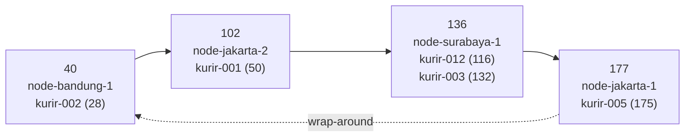
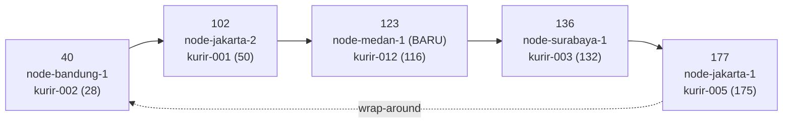
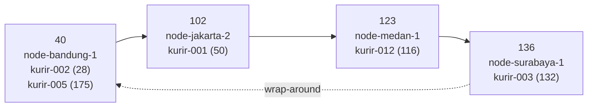

# Tugas 6 (Pekan 6) — Penamaan & Resolusi Lokasi

**Materi terkait:** Flat Naming, Structured Naming (DNS), Distributed Hash Table (DHT)/Chord.

## Studi Kasus

Pelanggan FoodGo kesulitan menemukan alamat IP server kurir yang **dinamis** (kurir berpindah lokasi/jaringan, IP-nya sering berubah). FoodGo butuh cara memetakan **ID Kurir** (identitas tetap) ke **alamat IP terkininya** tanpa server pusat tunggal yang jadi bottleneck/single point of failure.

## Tugas Kelompok

Implementasikan **simulasi Chord DHT** sederhana (single-process, tidak perlu jaringan sungguhan — cukup simulasi struktur data & algoritma di satu program Python) yang memetakan ID Kurir ke alamat IP mereka.

Konsep yang harus terlihat jalan dalam simulasi kalian:
1. **Consistent hashing**: ID Kurir dan ID Node di-hash ke ruang angka yang sama (mis. 0–255 untuk kesederhanaan, `m=8` bit).
2. **Ring topology**: node-node diurutkan melingkar berdasarkan hasil hash-nya.
3. **Lookup**: fungsi `lookup(kurir_id)` yang menemukan node mana yang bertanggung jawab menyimpan mapping ID Kurir tersebut → alamat IP-nya (aturan Chord: node dengan ID hash **terkecil yang lebih besar atau sama dengan** hash key, disebut *successor*).
4. **Perubahan topologi**: simulasikan minimal satu node baru bergabung (`join`) atau satu node keluar (`leave`), tunjukkan bagaimana mapping berpindah tanggung jawab ke node lain.

Skeleton disediakan di `src/chord_simulation.py` dengan fungsi hashing dan struktur ring sudah ada — bagian `lookup()`, `join()`, dan `leave()` sengaja dikosongkan.

### Cara Menjalankan

```bash
python3 src/chord_simulation.py
```

## Tugas Analisis (`README.md`)

### 1. Kenapa DHT/Chord lebih cocok dibanding flat naming sederhana atau DNS konvensional

Pada sistem FoodGo, setiap kurir memiliki ID unik yang bersifat tetap, misalnya `kurir-001`. Namun, alamat IP kurir dapat berubah ketika berpindah dari Wi-Fi ke data seluler atau berpindah lokasi. Kondisi ini mengharuskan sistem melakukan pembaruan pemetaan ID → IP secara dinamis agar kurir tetap dapat ditemukan melalui ID yang sama meskipun alamat IP-nya berubah. Oleh karena itu, FoodGo membutuhkan mekanisme penamaan yang memenuhi tiga kebutuhan utama:

1. **Pembaruan dinamis:** perubahan alamat IP dapat dicatat tanpa mengubah identitas kurir.
2. **Pencarian efisien:** sistem dapat menemukan alamat IP terbaru berdasarkan ID kurir dengan cepat.
3. **Ketersediaan sistem:** proses pencarian tidak bergantung pada satu server yang dapat menjadi *single point of failure* (SPOF).

#### a. Dibandingkan Flat Naming Sederhana (Tabel Pusat ID → IP)

| Aspek | Tabel Pusat ID → IP | Chord DHT |
| :---: | :---: | :---: |
| Penyimpanan | Seluruh pemetaan disimpan pada satu server | Pemetaan dibagi ke beberapa node berdasarkan hash ID |
| Pembaruan IP | Seluruh pembaruan diproses server pusat | Pembaruan diarahkan ke node penanggung jawab |
| Pencarian | Cepat selama server pusat tersedia | Efisien melalui *finger table* dengan rata-rata O(log N) hop |
| Kegagalan server | Server pusat mati menyebabkan seluruh layanan pencarian terganggu | Tanggung jawab dapat dialihkan ke node lain; pemulihan data membutuhkan mekanisme yang sesuai |
| Beban sistem | Berpotensi mengalami *bottleneck* ketika permintaan meningkat | Beban tersebar di berbagai node |
| Skalabilitas | Memerlukan peningkatan kapasitas server atau perubahan arsitektur | Node baru dapat bergabung melalui mekanisme `join()` |

Ketika banyak kurir berpindah jaringan secara bersamaan, server pusat harus menangani seluruh pembaruan alamat IP. Hal ini berpotensi menimbulkan *bottleneck* dan menjadi masalah apabila server mengalami gangguan. Sebaliknya, Chord menggunakan *consistent hashing* untuk menentukan node yang bertanggung jawab atas setiap ID kurir. Dengan demikian, beban penyimpanan dan pembaruan tidak terkonsentrasi pada satu server.

Dalam simulasi FoodGo, ketika `node-jakarta-1` keluar dari jaringan, pemetaan `kurir-005` dialihkan ke node lain sehingga proses *lookup* tetap berhasil. Selain itu, penambahan node baru hanya menyebabkan sebagian key berpindah, yaitu `kurir-012`, sehingga perubahan keanggotaan jaringan tidak mengharuskan seluruh data didistribusikan ulang.

#### b. Dibandingkan DNS Konvensional (Structured Naming)

DNS menggunakan sistem penamaan hierarkis dan mekanisme *caching* untuk menerjemahkan nama domain menjadi alamat IP. Meskipun DNS mendukung pembaruan alamat IP, penggunaannya kurang praktis untuk kebutuhan pemetaan ID kurir yang sangat dinamis.

| Aspek | DNS Konvensional | Chord DHT |
| :---: | :---: | :---: |
| Struktur penamaan | Hierarkis, seperti `kurir001.foodgo.id` | Menggunakan ID datar, seperti `kurir-001` |
| Pembaruan IP | Memerlukan pembaruan *record* DNS | Memperbarui nilai pada key yang menjadi tanggung jawab node |
| Informasi IP lama | Cache dapat menyimpan IP lama hingga TTL berakhir | Alamat IP dapat diperbarui pada node penanggung jawab tanpa menunggu TTL cache DNS |
| Pengelolaan | Memerlukan pengelolaan zona dan *record* DNS | Menggunakan distribusi key berdasarkan hash |
| Ketahanan gangguan | Bergantung pada ketersediaan infrastruktur DNS yang digunakan | Dapat menggunakan beberapa node serta mekanisme replikasi dan pemulihan |

Permasalahan utama DNS adalah potensi keterlambatan penggunaan alamat IP terbaru akibat mekanisme *Time to Live* (TTL). Sebagai contoh, ketika `kurir-001` berpindah dari Wi-Fi ke data seluler, alamat IP-nya berubah. Meskipun *record* DNS telah diperbarui, beberapa *resolver* masih dapat menyimpan alamat IP sebelumnya sampai masa TTL berakhir. TTL yang lebih pendek dapat mengurangi masalah tersebut, tetapi meningkatkan frekuensi permintaan resolusi.

Pada Chord, ID `kurir-001` diubah menjadi key melalui fungsi hash. Key tersebut menentukan node yang bertanggung jawab menyimpan pemetaan ID → IP. Saat IP berubah, nilai pemetaan dapat diperbarui tanpa mengubah ID atau posisi key pada ring.

Proses pencarian menggunakan *finger table* untuk mengarahkan permintaan menuju node penanggung jawab secara efisien. Dengan demikian, sistem tidak memerlukan pengelolaan nama domain hierarkis untuk setiap kurir.

#### c. Contoh Penerapan pada FoodGo

*(Contoh ini bersifat ilustrasi konseptual; perubahan IP kurir tidak diperagakan secara khusus dalam program simulasi.)*

Misalnya, kurir dengan ID `kurir-001` awalnya menggunakan IP `192.168.1.10`, kemudian berpindah jaringan sehingga memperoleh IP `10.20.30.40`.

Alur pada Chord:

1. **Registrasi:** ID `kurir-001` di-hash untuk menentukan key dan node penanggung jawab.
2. **Perubahan IP:** kurir mengirimkan pembaruan alamat IP ke sistem.
3. **Pembaruan data:** node penanggung jawab mengganti nilai IP lama dengan IP baru tanpa mengubah key.
4. **Pencarian:** ketika sistem membutuhkan IP `kurir-001`, Chord menggunakan `lookup()` untuk menemukan node penyimpan pemetaan.
5. **Hasil:** sistem memperoleh IP yang sudah diperbarui, selama proses pembaruan berhasil dan data telah konsisten.

Dengan mekanisme tersebut, perubahan alamat IP tidak memengaruhi identitas kurir maupun struktur penamaan sistem.

#### Kesimpulan Bagian 1

DHT/Chord lebih cocok untuk kebutuhan FoodGo karena mampu mengelola pemetaan ID → IP yang sering berubah secara terdistribusi dan efisien.

Dibandingkan tabel pusat, Chord mengurangi ketergantungan pada satu server serta membagi beban pembaruan dan pencarian. Dibandingkan DNS konvensional, Chord lebih sesuai untuk identitas datar yang membutuhkan pembaruan pemetaan secara langsung tanpa ketergantungan pada TTL cache DNS.

Penggunaan *consistent hashing*, *finger table*, dan mekanisme perpindahan tanggung jawab key juga mendukung skalabilitas ketika jumlah node berubah. Dengan tambahan replikasi dan pemulihan data, Chord dapat meningkatkan ketersediaan layanan dan mengurangi risiko *single point of failure*.

Dengan demikian, keunggulan utama Chord pada kasus FoodGo bukan sekadar kecepatan pencarian, melainkan kemampuannya mempertahankan identitas kurir yang tetap meskipun alamat IP berubah, sambil mendistribusikan pengelolaan pemetaan ke beberapa node.

---

### 2. Ring topology simulasi dan penanggung jawab ID Kurir

Simulasi FoodGo menggunakan **Chord DHT** dengan ruang identifier **8-bit** (`m = 8`), sehingga nilai hash berada pada rentang **0–255**. Setiap node dan ID kurir dipetakan ke dalam *hash ring* menggunakan fungsi hash.

Dalam Chord, setiap ID kurir menjadi tanggung jawab **node pertama searah jarum jam yang memiliki hash lebih besar atau sama dengan hash ID tersebut** (*successor*). Apabila tidak ada node yang memenuhi, penentuan kembali ke node dengan hash terkecil (*wrap-around*).

#### Nilai Hash Hasil Simulasi

| Node | Hash | ID Kurir | Hash |
|---|---:|---|---:|
| `node-bandung-1` | 40 | `kurir-002` | 28 |
| `node-jakarta-2` | 102 | `kurir-001` | 50 |
| `node-medan-1` (bergabung) | 123 | `kurir-012` | 116 |
| `node-surabaya-1` | 136 | `kurir-003` | 132 |
| `node-jakarta-1` (keluar) | 177 | `kurir-005` | 175 |

#### a. Ring Awal (4 Node)



Pada kondisi awal, terdapat **empat node aktif**. `node-surabaya-1` menangani dua ID kurir, yaitu `kurir-012` dan `kurir-003`, sedangkan tiga node lainnya masing-masing menangani satu ID kurir. Panah menunjukkan hubungan *successor* antar-node.

#### b. Ring Setelah `node-medan-1` Bergabung



Setelah `node-medan-1` (hash 123) bergabung, **`kurir-012` (hash 116)** berpindah dari `node-surabaya-1` ke `node-medan-1`. Hal ini memperlihatkan prinsip *consistent hashing*: penambahan node hanya mengubah tanggung jawab atas sebagian key, bukan seluruh pemetaan.

#### c. Ring Akhir Setelah `node-jakarta-1` Keluar



Ketika `node-jakarta-1` (hash 177) keluar, **`kurir-005` (hash 175)** menjadi tanggung jawab `node-bandung-1` (hash 40). Karena tidak ada node aktif dengan hash ≥ 175, penentuan *successor* kembali ke node dengan hash terkecil melalui mekanisme *wrap-around*.

#### d. Ringkasan Pemetaan ID Kurir pada Kondisi Akhir

| Node | Hash | Rentang Key yang Ditangani | ID Kurir |
|---|---:|---|---|
| `node-bandung-1` | 40 | 137–255 dan 0–40 (*wrap-around*) | `kurir-002` (28), `kurir-005` (175) |
| `node-jakarta-2` | 102 | 41–102 | `kurir-001` (50) |
| `node-medan-1` | 123 | 103–123 | `kurir-012` (116) |
| `node-surabaya-1` | 136 | 124–136 | `kurir-003` (132) |

#### Kesimpulan Bagian 2

Berdasarkan hasil simulasi, Chord DHT menggunakan *consistent hashing* untuk mendistribusikan ID kurir ke node penanggung jawab. Saat `node-medan-1` bergabung, hanya `kurir-012` yang berpindah. Setelah `node-jakarta-1` keluar, tanggung jawab `kurir-005` beralih ke `node-bandung-1` melalui mekanisme *wrap-around*.

Hal ini menunjukkan bahwa Chord dapat menyesuaikan distribusi key ketika topologi jaringan berubah **tanpa memindahkan seluruh data**.

---

### 3. Apa yang terjadi pada mapping saat node keluar dari ring

Pada simulasi **FoodGo**, `node-jakarta-1` dengan hash **177** keluar dari ring Chord. Sebelum keluar, node tersebut bertanggung jawab atas `kurir-005` (hash **175**) karena node 177 merupakan *successor* pertama dengan hash yang lebih besar atau sama dengan 175.

Ketika node 177 keluar, node yang tersisa memiliki hash **40, 102, 123, dan 136**. Karena tidak ada node dengan hash ≥ 175, pencarian mengikuti mekanisme **wrap-around**, yaitu kembali ke node dengan hash terkecil. Dengan demikian, **`node-bandung-1` (hash 40) mengambil alih mapping `kurir-005`**.

#### a. Perubahan Mapping

| Aspek | Sebelum node keluar | Setelah node keluar |
|---|---|---|
| Node penanggung jawab `kurir-005` | `node-jakarta-1` (177) | `node-bandung-1` (40) |
| Hash ID kurir | 175 | 175 (tetap) |
| Alamat IP kurir | `192.168.1.14` | `192.168.1.14` (tetap) |
| Mekanisme | *Successor* dari hash 175 adalah node 177 | *Wrap-around* ke node 40 |

#### b. Bukti Output Program

Berdasarkan cuplikan output pada `bukti/output.log`:

```text
--- Sebuah node keluar ---
[LEAVE] kurir-005 (hash=175) berpindah dari node 177 ke node 40
[LEAVE] Node 'node-jakarta-1' (id=177) keluar dari ring
[LOOKUP] kurir-005 ditemukan di node 40
kurir-005 -> 192.168.1.14
[LOOKUP] kurir-002 ditemukan di node 40
kurir-002 -> 192.168.1.11
```

Output menunjukkan bahwa setelah node 177 keluar, pemetaan `kurir-005` dipindahkan ke node 40. Perintah `lookup()` tetap berhasil menemukan `kurir-005` dengan alamat IP yang sama, yaitu `192.168.1.14`. Sementara itu, `kurir-002` tetap berada di node 40 dan masih dapat ditemukan.

#### c. Dampak terhadap Ring

- **Perpindahan terbatas:** Hanya mapping milik node yang keluar, yaitu `kurir-005`, yang dialihkan. Pemetaan `kurir-001`, `kurir-002`, `kurir-003`, dan `kurir-012` tidak berubah.
- **Identitas dan alamat IP tetap:** ID `kurir-005`, nilai hash 175, dan IP `192.168.1.14` tidak berubah; yang berubah hanya node penyimpannya.
- **Layanan pencarian tetap berjalan:** Setelah proses `leave()` selesai, `lookup("kurir-005")` berhasil melalui node penanggung jawab yang baru.

Sebagai pembanding, ketika `node-medan-1` (hash 123) bergabung, hanya mapping `kurir-012` (hash 116) yang berpindah dari node 136 ke node 123:

```text
--- Node baru bergabung ---
[JOIN] kurir-012 (hash=116) berpindah dari node 136 ke node 123
[JOIN] Node 'node-medan-1' (id=123) bergabung, alamat 10.0.0.5
[LOOKUP] kurir-012 ditemukan di node 123
kurir-012 -> 192.168.1.13
```

#### Kesimpulan Bagian 3

Pada simulasi FoodGo, ketika `node-jakarta-1` (177) keluar, **`node-bandung-1` (40) sebagai *successor* berikutnya mengambil alih mapping `kurir-005` (175)** melalui *wrap-around*. Perpindahan tersebut tidak mengubah ID maupun IP kurir, dan proses pencarian tetap berhasil. Hal ini memperlihatkan bahwa Chord dapat menyesuaikan pembagian tanggung jawab key saat keanggotaan ring berubah tanpa memindahkan seluruh mapping.

## Struktur Submission

```
tugas-06-penamaan-dht/
├── README.md      # Analisis + diagram ring
├── JURNAL.md
├── src/
│   └── chord_simulation.py
└── bukti/          # Output program (screenshot/log) untuk skenario join & leave
    └── output.log
```

## Rubrik Penilaian (Tugas 6)

| Komponen | Bobot | Kriteria |
|---|---|---|
| Implementasi lookup/join/leave benar | 35% | Consistent hashing & successor lookup sesuai aturan Chord |
| Bukti perubahan topologi (join/leave) | 25% | Output menunjukkan mapping berpindah dengan benar |
| Analisis kenapa DHT vs flat naming/DNS | 25% | Argumen spesifik ke kasus IP kurir dinamis, bukan definisi umum |
| Proses & kontribusi kelompok | 15% | `JURNAL.md`, commit history |

## Batasan Penggunaan AI (Level 2)

Kebijakan **Level 2 (AI Assisted Idea Generation & Structuring)** berlaku — lihat [`../RUBRIK-UMUM.md`](../RUBRIK-UMUM.md). Boleh bertanya konsep umum consistent hashing/Chord ke AI; **tidak boleh** meminta AI menuliskan isi `# TODO` di `src/chord_simulation.py` (`find_successor`, `join`, `leave`, dst). Catat pemakaian AI di "Log Penggunaan AI" pada `JURNAL.md`.

- `README.md` wajib menelusuri manual (langkah demi langkah) bagaimana `lookup()` menemukan successor untuk salah satu ID Kurir contoh yang dipakai di `chord_simulation.py` — bukan cuma menempelkan output program.
