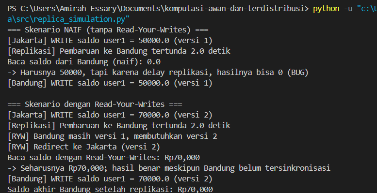

# Jurnal Proses — Tugas 7

## Diskusi Pemilihan Model Konsistensi

- **Argumen yang dipertimbangkan:**

  Pada studi kasus FoodGo, perbedaan saldo e-wallet antara server Jakarta dan Bandung terjadi akibat keterlambatan replikasi data. Dua model yang dibandingkan adalah Sequential Consistency dan Eventual Consistency.

  Eventual Consistency memungkinkan perbedaan saldo sementara antarreplika hingga proses sinkronisasi selesai. Model ini kurang sesuai jika diterapkan tanpa mekanisme tambahan pada sistem e-wallet karena pelanggan dapat mengalami penolakan transaksi meskipun saldo sudah mencukupi.

  Sequential Consistency lebih sesuai karena menjaga urutan operasi pembacaan dan penulisan secara konsisten. Dari sisi bisnis, ketidaksesuaian saldo dapat menyebabkan kegagalan transaksi, meningkatkan keluhan, menurunkan kepercayaan pelanggan, serta berpotensi mengurangi pendapatan FoodGo.

  Selain itu, dibandingkan dengan jumlah like di media sosial yang masih dapat mentoleransi keterlambatan pembaruan, saldo e-wallet membutuhkan jaminan konsistensi lebih ketat karena berkaitan langsung dengan transaksi keuangan.

- **Kesimpulan akhir & alasan:**

  Berdasarkan analisis tersebut, Sequential Consistency lebih tepat dibandingkan Eventual Consistency murni. Namun, Sequential Consistency tidak otomatis menjamin pembacaan data terbaru berdasarkan waktu nyata. Oleh karena itu, pendekatan yang diusulkan adalah Read-Your-Writes Consistency.

  Mekanisme ini menggunakan nomor versi data untuk memastikan pelanggan dapat membaca hasil top-up yang telah berhasil dilakukan. Jika server Bandung belum memiliki versi terbaru, pembacaan dialihkan ke server Jakarta. Proses pembayaran tetap memerlukan validasi dan pemotongan saldo secara atomik agar integritas data terjaga.

## Simulasi

- **Proses implementasi:**

  Simulasi menggunakan Python melalui file `src/replica_simulation.py` dengan dua replika, yaitu Jakarta dan Bandung. Keterlambatan replikasi disimulasikan menggunakan `threading.Timer()` selama 2 detik.

  Implementasi meliputi tiga bagian utama:
  1. **TODO 1:** Menambahkan replikasi tertunda dari Jakarta ke Bandung menggunakan `threading.Timer()`.
  2. **TODO 2:** Mengimplementasikan Read-Your-Writes dengan pemeriksaan versi data dan pengalihan pembacaan ke Jakarta apabila Bandung belum sinkron.
  3. **TODO 3:** Memanggil fungsi Read-Your-Writes pada skenario pengujian untuk membuktikan bahwa saldo terbaru tetap dapat dibaca sebelum replikasi selesai.

- **Hasil skenario naif vs Read-Your-Writes:**

  Pada skenario naif, pelanggan melakukan top-up Rp50.000 melalui server Jakarta. Setelah 0,5 detik, sistem membaca saldo dari Bandung yang belum menerima pembaruan sehingga masih menunjukkan Rp0. Kondisi tersebut membuktikan terjadinya *inconsistent read*.

  Pada skenario Read-Your-Writes, pelanggan melakukan top-up tambahan Rp20.000 sehingga saldo Jakarta menjadi Rp70.000 (versi 2). Ketika pembacaan dilakukan melalui Bandung, sistem mendeteksi bahwa versi lokal masih 1 dan mengalihkan pembacaan ke Jakarta. Hasilnya, saldo Rp70.000 berhasil diperoleh tanpa menunggu replikasi selesai.

  | Aspek Pengujian | Skenario Naif | Read-Your-Writes |
  |---|---|---|
  | Saldo Jakarta | Rp50.000 | Rp70.000 |
  | Saldo Bandung sebelum replikasi | Rp0 | Rp50.000 |
  | Versi Jakarta | 1 | 2 |
  | Versi Bandung | 0 | 1 |
  | Saldo yang dibaca | Rp0 | Rp70.000 |
  | Mekanisme | Pembacaan langsung | Redirect ke Jakarta |
  | Hasil | Inconsistent Read | Pembacaan konsisten |

- **Kesimpulan simulasi:**

  Hasil pengujian menunjukkan bahwa keterlambatan replikasi dapat menyebabkan pembacaan saldo yang tidak sesuai. Penerapan Read-Your-Writes menggunakan pemeriksaan versi dan pengalihan pembacaan ke server terbaru berhasil mengatasi masalah tersebut.

  Setelah proses replikasi selesai, kedua server memiliki saldo yang sama, yaitu Rp70.000. Dengan demikian, simulasi menunjukkan perbedaan antara pembacaan tanpa jaminan konsistensi dan pembacaan yang menerapkan Read-Your-Writes.

  Bukti hasil pengujian :
  
  
  

## Log Penggunaan AI (Level 2)

> Wajib diisi sesuai kebijakan Level 2 di [`../RUBRIK-UMUM.md`](../RUBRIK-UMUM.md). Tulis "Tidak memakai AI" pada baris pertama jika memang tidak dipakai. Hanya untuk brainstorming ide/outline — bukan untuk kode/analisis/teks akhir.

| Tanggal | Tool AI | Prompt yang diberikan | Ringkasan saran/ide AI | Bagaimana diolah jadi tulisan/kode sendiri |
|---|---|---|---|---|
| 14 November 2026 | ChatGPT | Membandingkan Sequential Consistency dan Eventual Consistency pada kasus FoodGo. | Penjelasan perbedaan model konsistensi, dampak bisnis, dan penerapan Read-Your-Writes. | ChatGPT membantu menyusun draf analisis dan solusi yang digunakan sebagai bahan pengerjaan README. |
| 14 November 2026 | ChatGPT | Membuat sequence diagram kondisi sebelum dan sesudah penerapan Read-Your-Writes. | Contoh alur top-up, keterlambatan replikasi, dan pemeriksaan versi saldo. | Diagram disusun dengan bantuan AI untuk dokumentasi README. |
| 14 November 2026 | ChatGPT | Membantu melengkapi TODO simulasi Python. | Contoh penggunaan `threading.Timer()`, pemeriksaan versi, dan pengalihan pembacaan ke Jakarta. | Kode diberikan dengan bantuan AI, kemudian dijalankan dan hasilnya diperiksa melalui terminal VS Code. |
| 14 November 2026 | ChatGPT | Membantu merapikan README, JURNAL, dan skenario tambahan. | Saran struktur Markdown, dokumentasi pengujian, dan contoh Eventual Consistency pada lokasi pengemudi. | Draf dokumentasi dibuat dengan bantuan AI dan disesuaikan dengan pembahasan tugas serta output simulasi. |