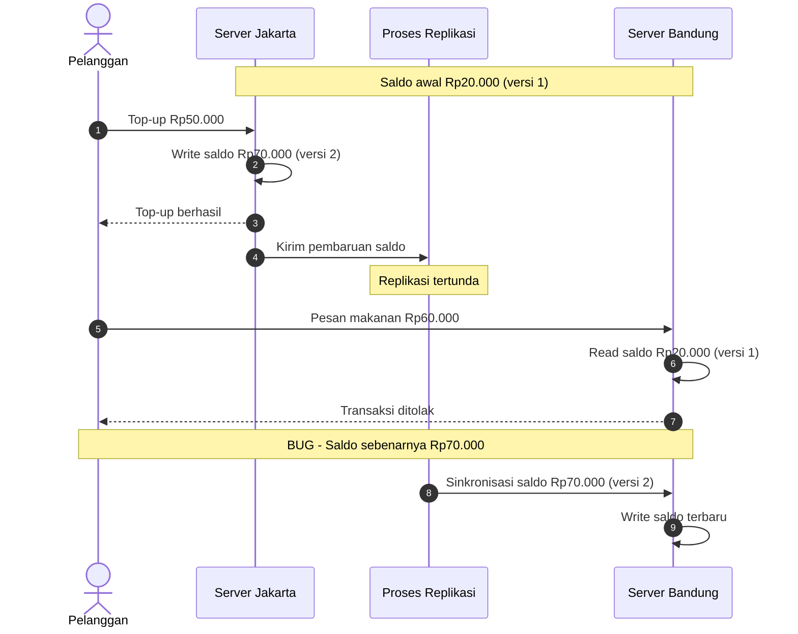
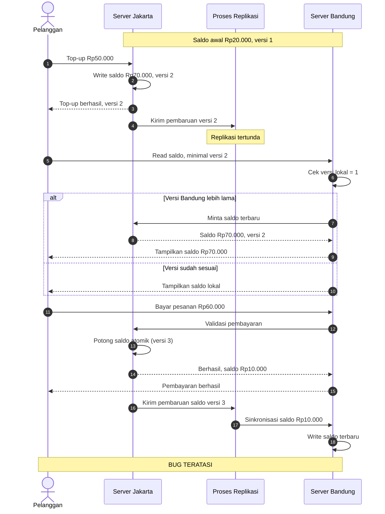

# Tugas 7 (Pekan 7) — Konsistensi Data

**Materi terkait:** Data-Centric Consistency (Sequential, Eventual), Client-Centric Consistency.

## Studi Kasus

Data saldo *e-wallet* pelanggan FoodGo berbeda antara server wilayah **Jakarta** dan **Bandung** karena replikasi antar server berjalan lambat. Contoh kasus nyata: pelanggan top-up saldo lewat server Jakarta, lalu dalam hitungan detik memesan makanan lewat aplikasi yang tersambung ke server Bandung — saldo belum ter-update, transaksi ditolak padahal saldo sebenarnya cukup.

## Tugas Kelompok

### Bagian 1 — Analisis (wajib)

### 1. Pemilihan Model Konsistensi
Kasus FoodGo membutuhkan konsistensi data yang lebih ketat dibandingkan Eventual Consistency murni. **Sequential Consistency lebih sesuai** karena memastikan operasi pembacaan dan penulisan dapat dipandang berlangsung dalam satu urutan yang konsisten, dengan tetap mempertahankan urutan operasi setiap proses. Sebaliknya, Eventual Consistency memungkinkan perbedaan data sementara antarreplika hingga sinkronisasi selesai.

**Perbandingan model:**

| Aspek | Eventual Consistency | Sequential Consistency |
|---|---|---|
| Jaminan | Replika akhirnya sama, tanpa batas waktu | Semua proses melihat urutan operasi yang sama |
| Pembacaan stale | Boleh terjadi dan tidak terbatas | Urutan konsisten, tetapi tidak harus sesuai waktu nyata |
| Latensi dan ketersediaan | Paling baik | Lebih mahal karena perlu koordinasi |
| Cocok untuk | Jumlah like, lokasi pengemudi, feed | Saldo, pembayaran, pesanan |

Sebagai ilustrasi, pelanggan memiliki saldo awal Rp20.000 dan melakukan top-up Rp50.000 melalui server Jakarta sehingga saldo menjadi Rp70.000. Namun, ketika pelanggan memesan makanan seharga Rp60.000 melalui server Bandung, sistem masih membaca saldo Rp20.000 akibat keterlambatan replikasi. Kondisi ini menyebabkan transaksi ditolak meskipun saldo sebenarnya mencukupi.

Dari sisi bisnis, ketidakkonsistenan tersebut dapat mengakibatkan kegagalan transaksi, menurunkan kepercayaan pelanggan, meningkatkan keluhan, dan berpotensi mengurangi pendapatan FoodGo. Berbeda dengan jumlah like di media sosial yang masih dapat mentoleransi keterlambatan pembaruan, ketidaksesuaian saldo e-wallet berdampak langsung pada transaksi keuangan. Oleh karena itu, Eventual Consistency saja tidak cukup. Meskipun demikian, Sequential Consistency hanya menjamin urutan operasi yang sama bagi semua proses, bukan bahwa pembacaan selalu yang terbaru menurut waktu nyata. Jaminan itu baru diberikan oleh strong consistency (linearizability), yang biayanya lebih tinggi karena setiap operasi harus dikoordinasikan antarserver. Karena itu, diperlukan mekanisme tambahan di sisi klien agar pelanggan pasti dapat membaca hasil top-up yang telah berhasil dilakukan.

### 2. Penerapan Client-Centric Consistency
Pendekatan yang diusulkan adalah **Read-Your-Writes Consistency**, yaitu mekanisme yang memastikan pelanggan dapat membaca perubahan data yang sebelumnya berhasil dilakukan sendiri, meskipun replikasi antarserver belum selesai.

Pada sistem FoodGo, setiap pembaruan saldo diberikan nomor versi. Setelah pelanggan melakukan top-up melalui server Jakarta, aplikasi pelanggan menyimpan versi terbaru sebagai session token dan menyertakannya pada setiap permintaan baca berikutnya. Ketika pelanggan mengakses server Bandung, sistem membandingkan versi data lokal dengan versi terakhir milik pelanggan. Jika versi Bandung lebih lama, pembacaan dialihkan ke Jakarta atau menunggu replikasi hingga versi yang dibutuhkan tersedia.

**Tahapan implementasi:**
1. Pelanggan melakukan top-up Rp50.000 melalui server Jakarta.
2. Server Jakarta memperbarui saldo menjadi Rp70.000 dan menaikkan versi data dari 1 menjadi 2.
3. Sistem mencatat versi 2 sebagai versi terakhir yang berhasil ditulis pelanggan.
4. Ketika pelanggan mengakses Bandung, sistem memeriksa apakah versi saldo sudah mencapai versi 2.
5. Jika Bandung masih menyimpan versi 1, pembacaan dialihkan ke Jakarta.
6. Pelanggan memperoleh saldo Rp70.000 dan dapat melanjutkan pembayaran.

Dengan mekanisme tersebut, pelanggan tidak lagi membaca saldo lama setelah top-up. Untuk menjaga integritas data keuangan, validasi dan pemotongan saldo tetap harus dilakukan secara atomik pada sumber data yang otoritatif agar tidak terjadi penggunaan saldo ganda.

**Kelebihan dan batasan:**
- Kelebihan: ringan karena hanya melibatkan satu pelanggan dan server lain tidak perlu dikunci.
- Batasan: bila Jakarta tidak dapat dijangkau, pembacaan harus menunggu replikasi sehingga latensi naik. Jaminan ini hanya berlaku untuk tulisan milik pelanggan itu sendiri.
- Pembayaran tidak boleh hanya mengandalkan hasil baca, karena tanpa validasi atomik pelanggan bisa membayar dua pesanan hampir bersamaan dari dua server (double spending).

### 3. Sequence Diagram
Sequence diagram berikut menggambarkan perbedaan alur pembacaan dan pembaruan saldo pada sistem FoodGo sebelum dan sesudah penerapan Read-Your-Writes Consistency.

#### 3.1 Tanpa Jaminan Konsistensi (Bug Terjadi)
Pada skenario ini, server Jakarta telah memperbarui saldo pelanggan, tetapi proses replikasi ke Bandung mengalami keterlambatan. Akibatnya, server Bandung masih membaca saldo lama dan menolak transaksi yang seharusnya dapat dilakukan.

**Analisis:** Kegagalan terjadi saat Bandung membaca saldo Rp20.000 sebelum menerima pembaruan dari Jakarta. Walaupun kedua server akhirnya tersinkronisasi, transaksi pelanggan sudah terlanjur ditolak.

#### 3.2 Dengan Read-Your-Writes Consistency (Bug Teratasi)
Pada skenario ini, sistem memeriksa versi saldo sebelum melayani permintaan pelanggan. Apabila server Bandung belum memiliki versi terbaru, pembacaan dialihkan ke Jakarta sehingga transaksi dapat diproses menggunakan saldo yang sesuai.

**Analisis:** Pemeriksaan versi mencegah penggunaan saldo lama pada server Bandung. Ketika versi data belum sesuai, sistem mengambil saldo terbaru dari Jakarta. Pelanggan dapat menyelesaikan pembayaran Rp60.000 dengan saldo awal setelah top-up sebesar Rp70.000, sehingga saldo akhir menjadi Rp10.000.

### Kesimpulan
Eventual Consistency saja tidak cukup untuk menangani saldo e-wallet FoodGo karena keterlambatan replikasi dapat menyebabkan kegagalan transaksi. Sequential Consistency lebih sesuai untuk menjaga urutan operasi yang konsisten, sedangkan **Read-Your-Writes Consistency** digunakan untuk memastikan pelanggan dapat membaca hasil top-up meskipun replika lain belum tersinkronisasi. Penerapan pemeriksaan versi data, pengalihan pembacaan ke server terbaru, serta pemrosesan pembayaran secara atomik dapat meningkatkan keandalan transaksi dan menjaga kepercayaan pelanggan terhadap layanan FoodGo.

### Bagian 2 — Simulasi 

### 1. Simulasi Inconsistent Read
Simulasi dilakukan menggunakan Python melalui file `src/replica_simulation.py` dengan dua replika, yaitu server Jakarta dan Bandung. Proses replikasi menggunakan `threading.Timer()` dengan keterlambatan buatan selama 2 detik untuk menunjukkan kondisi *inconsistent read*, yaitu ketika salah satu server masih membaca data lama meskipun server lain telah memperbaruinya. Pada skenario pertama, pelanggan melakukan top-up Rp50.000 melalui server Jakarta sehingga saldo menjadi Rp50.000 (versi 1). Setelah 0,5 detik, pelanggan membaca saldo melalui server Bandung. Karena replikasi belum selesai, Bandung masih menampilkan saldo Rp0 (versi 0). Hal ini membuktikan terjadinya *inconsistent read* akibat keterlambatan sinkronisasi data antarserver.

### 2. Implementasi Read-Your-Writes Consistency
Untuk mengatasi masalah tersebut, diterapkan mekanisme **Read-Your-Writes Consistency** dengan memanfaatkan nomor versi data (`last_write_version`). Mekanisme ini memastikan pelanggan dapat membaca hasil pembaruan saldo yang telah dilakukan sendiri, meskipun server tujuan belum menerima replikasi terbaru. Pada skenario kedua, pelanggan melakukan top-up tambahan Rp20.000 melalui Jakarta sehingga saldo menjadi Rp70.000 (versi 2). Ketika pelanggan langsung membaca saldo melalui Bandung, sistem mendeteksi bahwa Bandung masih memiliki versi 1, sedangkan pelanggan membutuhkan versi 2. Oleh karena itu, pembacaan dialihkan (*redirect*) ke Jakarta yang memiliki versi terbaru, sehingga saldo Rp70.000 berhasil ditampilkan tanpa menunggu replikasi selesai.

### 3. Hasil Pengujian
| Komponen Pengujian | Skenario Naif | Read-Your-Writes |
|---|---|---|
| Saldo Jakarta | Rp50.000 | Rp70.000 |
| Saldo Bandung sebelum replikasi | Rp0 | Rp50.000 |
| Versi Jakarta | 1 | 2 |
| Versi Bandung | 0 | 1 |
| Saldo yang dibaca | Rp0 | Rp70.000 |
| Mekanisme pembacaan | Langsung dari Bandung | Redirect ke Jakarta |
| Hasil | Inconsistent Read | Konsisten |

### 4. Kesimpulan Simulasi
Hasil simulasi menunjukkan bahwa keterlambatan replikasi selama 2 detik menyebabkan *inconsistent read* pada server Bandung. Tanpa mekanisme konsistensi tambahan, pelanggan membaca saldo Rp0 meskipun Jakarta telah memperbaruinya menjadi Rp50.000. Penerapan **Read-Your-Writes Consistency** menggunakan pemeriksaan versi data berhasil mengatasi masalah tersebut. Ketika Bandung belum memiliki versi terbaru, sistem mengalihkan pembacaan ke Jakarta sehingga pelanggan tetap memperoleh saldo yang sesuai. Setelah replikasi selesai, kedua server memiliki saldo yang sama, yaitu Rp70.000.

**Keterbatasan simulasi:** hanya terdapat dua replika dan satu pelanggan, tidak ada kegagalan server atau partisi jaringan, dan pemotongan saldo secara atomik (pembayaran) tidak disimulasikan.

## Bagian 3 — Skenario Tambahan

### Konsistensi Data Lokasi Pengemudi pada Aplikasi Ojek Online
Pada aplikasi ojek online, lokasi pengemudi diperbarui secara berkala dan dikirimkan ke beberapa server agar pelanggan dapat memantau posisi pengemudi melalui peta. Namun, keterlambatan jaringan atau proses replikasi dapat menyebabkan posisi yang ditampilkan pada perangkat pelanggan sedikit berbeda dari lokasi sebenarnya.

Model konsistensi yang tepat untuk skenario ini adalah **Eventual Consistency**, karena pembaruan lokasi tidak harus langsung diterima seluruh server pada waktu yang sama. Perbedaan posisi sementara masih dapat ditoleransi selama data terus diperbarui dan pada akhirnya tersinkronisasi. Model ini juga dapat mengurangi beban sinkronisasi antarreplika sehingga sistem lebih responsif ketika melayani banyak pengguna.

Agar tampilan peta tidak terasa janggal, dapat ditambahkan **Monotonic Reads** (client-centric): pelanggan tidak akan melihat posisi pengemudi "mundur" ke titik yang lebih lama saat aplikasinya berpindah server. Caranya dengan mencatat timestamp atau nomor urut pembaruan terakhir yang sudah ditampilkan, lalu mengabaikan data yang lebih lama. Kehilangan satu pembaruan juga hampir tidak berdampak karena segera digantikan pembaruan berikutnya.

Dari sisi bisnis, Eventual Consistency dapat membantu menjaga performa aplikasi dan efisiensi penggunaan jaringan. Namun, sistem tetap perlu mencantumkan waktu pembaruan lokasi serta menghindari penggunaan data yang terlalu lama agar pelanggan tidak memperoleh informasi posisi yang menyesatkan. Untuk proses yang lebih sensitif, seperti pembayaran dan penetapan pesanan kepada pengemudi, diperlukan jaminan konsistensi yang lebih ketat, misalnya penugasan melalui satu server otoritatif agar satu pesanan tidak diberikan kepada dua pengemudi.

**Kesimpulan:** Eventual Consistency sesuai untuk menampilkan lokasi pengemudi karena keterlambatan pembaruan dalam waktu singkat masih dapat diterima, dan dapat dilengkapi Monotonic Reads agar posisi tidak mundur. Berbeda dengan saldo e-wallet yang memengaruhi transaksi keuangan, data lokasi dapat menggunakan konsistensi yang lebih fleksibel dengan tetap memperhatikan kesegaran data.