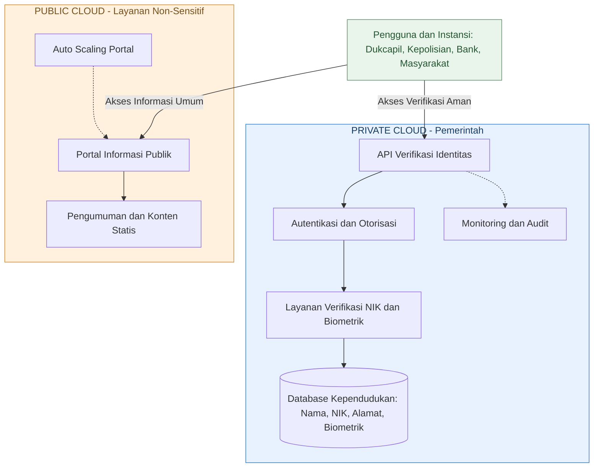

# Tugas 9 (Pekan 9) — Cloud Delivery & Deployment Model

**Materi terkait:** Karakteristik esensial cloud computing (NIST SP 800-145), Deployment Model (Public/Private/Hybrid/Community), Service Model (IaaS/PaaS/SaaS).

## Studi Kasus
Pemerintah ingin membangun **Sistem Data Kependudukan** (nama, NIK, alamat, data biometrik) yang:
- Sangat **rahasia** (data pribadi warga negara, diatur UU Perlindungan Data Pribadi).
- Diakses oleh **ribuan instansi** (dukcapil daerah, kepolisian, bank untuk verifikasi KYC) dengan pola akses yang **tidak rata** (lonjakan saat musim pemilu/pendaftaran sekolah).
- Butuh **skalabilitas** agar tidak downtime saat lonjakan akses, tapi **tidak boleh** datanya berada di infrastruktur yang tidak terkendali penuh oleh negara.

## Tugas Kelompok
## 1. Rekomendasi Deployment Model
### 1.1 Pemilihan Deployment Model
Deployment model yang kami rekomendasikan adalah **Hybrid Cloud**, yaitu gabungan antara Private Cloud dan Public Cloud. Model ini dipilih karena Sistem Data Kependudukan membutuhkan perlindungan data yang tinggi sekaligus kemampuan menangani jumlah akses yang berubah-ubah.

Dalam rancangan ini, penggunaan cloud dibagi menjadi dua bagian:
- **Private Cloud:** Digunakan untuk menyimpan dan memproses seluruh data utama kependudukan, seperti nama, NIK, alamat, dan data biometrik. Infrastruktur ini berada dalam kendali penuh pemerintah, termasuk pengelolaan server, penyimpanan, jaringan, dan kebijakan keamanannya.
- **Public Cloud:** Digunakan secara terbatas untuk layanan pendukung yang tidak menyimpan atau memproses data pribadi, seperti halaman informasi, pengumuman layanan, dan konten publik lainnya.

Pembagian ini juga mempertimbangkan **UU Nomor 27 Tahun 2022 tentang Pelindungan Data Pribadi**. Dalam undang-undang tersebut, data biometrik termasuk data pribadi yang bersifat spesifik sehingga memerlukan perlindungan yang lebih ketat. Oleh karena itu, akses terhadap data kependudukan harus dibatasi berdasarkan kewenangan dan tujuan penggunaan yang sah. Seluruh proses verifikasi identitas, termasuk pencocokan NIK dan biometrik, tetap dilakukan di Private Cloud. Public Cloud tidak digunakan untuk menyimpan salinan database kependudukan ataupun memproses permintaan verifikasi yang melibatkan data sensitif. Dengan demikian, Hybrid Cloud digunakan untuk memisahkan beban layanan publik dan layanan inti, bukan untuk memindahkan data sensitif ke Public Cloud. Rancangan ini juga harus mengikuti ketentuan penyelenggaraan sistem elektronik lingkup publik, termasuk persyaratan lokasi penyimpanan serta pengelolaan data yang berlaku.

### 1.2 Analisis Berdasarkan Karakteristik NIST
Pemilihan Hybrid Cloud mempertimbangkan lima karakteristik utama cloud computing menurut NIST SP 800-145.

#### a. On-Demand Self-Service
On-demand self-service memungkinkan penyediaan sumber daya komputasi secara otomatis tanpa harus melakukan konfigurasi manual setiap kali dibutuhkan. Pada Sistem Data Kependudukan, pemerintah dapat menyediakan tambahan server aplikasi atau kapasitas komputasi melalui sistem pengelolaan Private Cloud. Sebagai contoh, ketika permintaan verifikasi meningkat, sistem dapat menambahkan server aplikasi dari kapasitas yang sudah tersedia. Proses tersebut tetap mengikuti kebijakan pemerintah sehingga penambahan resource tidak memberikan akses baru terhadap data kependudukan secara otomatis.

#### b. Broad Network Access
Broad network access memungkinkan layanan cloud diakses melalui jaringan menggunakan perangkat atau aplikasi yang sesuai. Karakteristik ini penting karena Sistem Data Kependudukan digunakan oleh ribuan instansi di berbagai daerah. Dukcapil daerah, kepolisian, dan bank dapat menggunakan layanan verifikasi melalui aplikasi atau API yang disediakan pemerintah. Namun, setiap instansi tetap memiliki batasan akses sesuai kebutuhan. Misalnya, bank hanya dapat melakukan verifikasi identitas untuk kebutuhan KYC dan menerima hasil sesuai kewenangannya, bukan mengakses seluruh database warga. Akses juga perlu dilindungi menggunakan autentikasi, otorisasi, dan komunikasi terenkripsi agar data pribadi tidak dapat diakses oleh pihak yang tidak berwenang.

#### c. Resource Pooling
Resource pooling memungkinkan sumber daya seperti server, storage, dan jaringan digunakan bersama oleh banyak pengguna. Dalam sistem ini, pemerintah dapat menyediakan Private Cloud terpusat yang digunakan oleh berbagai instansi. Dengan begitu, setiap Dukcapil daerah tidak perlu membangun infrastruktur cloud sendiri. Instansi dapat menggunakan layanan yang sama dengan pembagian sumber daya sesuai kebutuhan. Meskipun menggunakan infrastruktur bersama, setiap instansi tetap memiliki batasan akses. Sebagai contoh, petugas Dukcapil dapat menjalankan fungsi administrasi kependudukan sesuai kewenangannya, sedangkan bank hanya menggunakan layanan verifikasi identitas. Pemisahan ini diperlukan untuk mencegah akses data di luar tujuan yang diperbolehkan.

#### d. Rapid Elasticity
Rapid elasticity memungkinkan kapasitas sistem bertambah atau berkurang dengan cepat mengikuti jumlah permintaan. Karakteristik ini sangat dibutuhkan karena permintaan verifikasi identitas dapat meningkat saat pemilu atau pendaftaran sekolah. Untuk mengatasinya, pemerintah dapat menerapkan **horizontal scaling (scaling out)** dengan menambahkan beberapa server aplikasi di Private Cloud. Permintaan kemudian dibagi menggunakan load balancer agar tidak hanya ditangani oleh satu server. Public Cloud dapat meningkatkan kapasitas portal informasi ketika jumlah pengunjung meningkat. Namun, penambahan kapasitas Public Cloud tidak secara langsung meningkatkan kemampuan database utama dalam memproses verifikasi NIK atau biometrik. Oleh karena itu, pemerintah tetap perlu menyediakan kapasitas cadangan, menerapkan autoscaling pada layanan aplikasi yang memungkinkan, dan melakukan pengujian beban pada Private Cloud. Dengan cara ini, peningkatan jumlah akses dapat ditangani tanpa harus memindahkan data sensitif ke Public Cloud.

#### e. Measured Service
Measured service memungkinkan penggunaan sumber daya cloud dipantau dan diukur melalui penggunaan CPU, storage, bandwidth, serta jumlah permintaan layanan. Dalam Sistem Data Kependudukan, pemerintah dapat memantau jumlah permintaan verifikasi dari setiap instansi dan penggunaan kapasitas server. Sebagai contoh, apabila suatu bank mengirimkan permintaan verifikasi dalam jumlah yang jauh lebih besar dari biasanya, aktivitas tersebut dapat diperiksa untuk memastikan tidak terjadi penyalahgunaan layanan Pengukuran ini juga membantu pemerintah mengevaluasi kebutuhan kapasitas serta menentukan kapan perlu menambah server. Pada Private Cloud pemerintah, measured service tidak harus digunakan untuk penagihan biaya, tetapi juga dapat dimanfaatkan untuk monitoring, pengawasan, dan efisiensi penggunaan resource.

### 1.3 Alasan Pemilihan Hybrid Cloud
Hybrid Cloud dipilih karena memungkinkan pemerintah memisahkan layanan berdasarkan tingkat sensitivitas data. Private Cloud digunakan untuk menjaga kendali penuh terhadap data kependudukan, sedangkan Public Cloud membantu menangani layanan pendukung non-sensitif.

Keunggulan utama rancangan ini adalah:
- Data NIK, alamat, dan biometrik tetap berada pada infrastruktur yang dikendalikan pemerintah.
- Ribuan instansi dapat menggunakan layanan terpusat melalui API dengan hak akses berbeda.
- Portal informasi publik dapat ditingkatkan kapasitasnya tanpa membebani server utama.
- Pengawasan akses dan penggunaan resource dapat dilakukan secara terpusat.

Walaupun demikian, Hybrid Cloud memiliki pengelolaan yang lebih kompleks karena menggabungkan dua lingkungan cloud. Penggunaan Public Cloud juga hanya dapat dilakukan apabila memenuhi kebijakan pemerintah dan tidak bertentangan dengan persyaratan kendali infrastruktur. Jika seluruh komponen diwajibkan berada dalam kendali penuh negara, Private Cloud murni menjadi pilihan yang lebih sesuai.

### 1.4 Diagram Arsitektur Hybrid Cloud

Diagram tersebut menunjukkan penerapan Hybrid Cloud pada Sistem Data Kependudukan. **Private Cloud** digunakan untuk penyimpanan data NIK, alamat, dan biometrik serta proses verifikasi identitas. **Public Cloud** hanya digunakan untuk layanan informasi non-sensitif yang dapat ditingkatkan kapasitasnya saat terjadi lonjakan akses. Data kependudukan tetap berada dalam infrastruktur yang dikendalikan pemerintah.

## 2. Rekomendasi Service Model
### 2.1 Pemilihan Service Model
Service model yang kami rekomendasikan adalah kombinasi **Infrastructure as a Service (IaaS), Platform as a Service (PaaS), dan Software as a Service (SaaS)**. Kombinasi ini dipilih karena setiap komponen Sistem Data Kependudukan memiliki kebutuhan pengelolaan yang berbeda. IaaS memberikan kendali lebih besar terhadap sistem operasi dan aplikasi, PaaS memudahkan pengembangan aplikasi, sedangkan SaaS menyediakan aplikasi yang siap digunakan.

### 2.2 Pemetaan Service Model
| Komponen Sistem | Service Model | Deployment Model | Alasan |
|---|---|---|---|
| Database utama kependudukan | IaaS | Private Cloud | Pemerintah membutuhkan kendali terhadap sistem operasi, database, penyimpanan, dan pengamanan data NIK serta alamat warga. |
| Sistem pemrosesan biometrik | IaaS | Private Cloud | Pemrosesan data biometrik membutuhkan konfigurasi khusus dan pengamanan ketat karena termasuk data pribadi spesifik. |
| API verifikasi identitas | PaaS | Private Cloud | Memudahkan pengembangan layanan verifikasi bagi Dukcapil, kepolisian, dan bank tanpa memberikan akses langsung ke database. |
| Portal informasi publik | PaaS | Public Cloud | Mendukung peningkatan jumlah pengunjung tanpa menyimpan atau memproses data pribadi warga. |
| Aplikasi monitoring internal | SaaS | Private Cloud | Petugas dapat memantau kapasitas server, status layanan, dan penggunaan resource melalui aplikasi yang disediakan pemerintah. |

### 2.3 Penjelasan Pemilihan Service Model
#### a. Infrastructure as a Service (IaaS)
IaaS digunakan untuk database utama kependudukan dan sistem pemrosesan biometrik karena pemerintah membutuhkan kendali besar terhadap komponen yang menyimpan serta memproses data pribadi warga. Dengan IaaS, pemerintah dapat mengatur sistem operasi, database, konfigurasi jaringan, enkripsi penyimpanan, dan mekanisme pencadangan data sesuai kebutuhan. Salah satu teknologi yang dapat digunakan untuk membangun Private Cloud adalah OpenStack. Namun, penggunaan IaaS juga berarti pemerintah bertanggung jawab terhadap pemeliharaan sistem operasi, pembaruan keamanan, serta pengelolaan aplikasi database dan biometrik.

#### b. Platform as a Service (PaaS)
PaaS digunakan untuk API verifikasi identitas dan portal informasi publik. Model ini memudahkan pengembang membuat dan mengelola aplikasi tanpa harus menangani seluruh infrastruktur secara langsung. Sebagai contoh, ketika bank melakukan verifikasi KYC, bank mengirimkan permintaan melalui API. Permintaan tersebut diproses pada layanan yang berjalan di Private Cloud, kemudian sistem mengembalikan hasil verifikasi sesuai kewenangan bank tanpa memberikan akses langsung ke database kependudukan. Sementara itu, portal informasi publik dapat menggunakan PaaS pada Public Cloud karena hanya menyediakan informasi umum dan tidak memproses data kependudukan.

#### c. Software as a Service (SaaS)
SaaS digunakan untuk aplikasi monitoring internal yang disediakan dalam lingkungan Private Cloud pemerintah. Petugas dapat memantau kondisi server, penggunaan resource, status layanan, dan aktivitas operasional melalui browser tanpa harus mengelola infrastruktur aplikasi tersebut secara langsung. Aplikasi monitoring tetap dibatasi untuk petugas berwenang karena informasi operasional sistem juga perlu dilindungi.

### 2.4 Alasan Penggunaan Beberapa Service Model
Kombinasi ketiga service model dipilih karena setiap komponen memiliki kebutuhan berbeda. IaaS memberikan kontrol lebih besar untuk pengelolaan data sensitif, PaaS mempermudah pengembangan aplikasi verifikasi, dan SaaS memudahkan penggunaan aplikasi pendukung.

## 3. Analisis Risiko dan Mitigasi
### 3.1 Risiko Kebocoran Data Kependudukan
**Risiko:** Kebocoran data dapat terjadi akibat kesalahan konfigurasi akses atau komunikasi antar-cloud. Misalnya, API yang tidak dikonfigurasi dengan benar menyebabkan NIK, alamat, atau informasi pribadi warga ikut terkirim ke layanan Public Cloud yang seharusnya hanya digunakan untuk informasi umum. Kebocoran tersebut dapat merugikan warga dan menimbulkan persoalan terkait pelindungan data pribadi.

**Mitigasi:**
- Menyimpan dan memproses seluruh data kependudukan di Private Cloud.
- Menerapkan autentikasi, otorisasi, dan prinsip least privilege bagi setiap instansi.
- Menggunakan enkripsi untuk komunikasi antarlayanan dan penyimpanan data.
- Membatasi informasi yang dikembalikan melalui API sesuai tujuan verifikasi.
- Mencatat aktivitas akses dan melakukan pemeriksaan secara berkala.

Langkah tersebut mengurangi risiko kebocoran karena akses terhadap data kependudukan dibatasi sesuai kewenangan dan kebutuhan masing-masing instansi.

### 3.2 Risiko Gangguan Koneksi dan Ketidaksesuaian Data
**Risiko:** Hybrid Cloud menggunakan lingkungan cloud yang berbeda sehingga komunikasi antarbagian sistem dapat mengalami gangguan. Selain itu, apabila data kependudukan disalin ke beberapa layanan, pembaruan informasi dapat menyebabkan ketidaksesuaian data. Sebagai contoh, seorang warga telah memperbarui alamat melalui Dukcapil, tetapi layanan verifikasi yang menggunakan salinan data lama masih menampilkan alamat sebelumnya. Hal ini dapat menyebabkan kesalahan dalam proses verifikasi identitas.

**Mitigasi:**
- Menjadikan database Private Cloud sebagai sumber data utama yang resmi.
- Tidak menyimpan salinan database kependudukan di Public Cloud.
- Menggunakan koneksi cadangan untuk menjaga ketersediaan komunikasi antarlayanan.
- Memantau kondisi jaringan dan layanan secara berkala.
- Melakukan verifikasi langsung ke sumber data utama untuk memperoleh informasi terbaru.

Dengan cara tersebut, risiko ketidaksesuaian data dapat dikurangi karena informasi resmi tetap berasal dari satu sumber yang dikendalikan pemerintah.

### 3.3 Risiko Lonjakan Akses dan Downtime
**Risiko:** Saat pemilu atau pendaftaran sekolah, ribuan instansi dapat mengirimkan permintaan verifikasi dalam waktu bersamaan. Jika kapasitas Private Cloud tidak mencukupi, layanan verifikasi NIK atau biometrik dapat menjadi lambat bahkan mengalami downtime. Gangguan tersebut dapat menghambat proses administrasi kependudukan, verifikasi identitas pemilih, atau pendaftaran siswa.

**Mitigasi:**
- Menerapkan horizontal scaling untuk menambah server aplikasi.
- Menggunakan load balancer untuk membagi permintaan verifikasi.
- Menyediakan kapasitas cadangan pada Private Cloud.
- Menerapkan rate limiting untuk mengatur jumlah permintaan dari setiap instansi.
- Melakukan load testing sebelum periode yang diperkirakan mengalami lonjakan akses.
- Menyediakan sistem antrean untuk permintaan yang tidak harus diproses secara langsung.

Langkah tersebut membantu mengurangi risiko downtime tanpa harus memindahkan database kependudukan ke Public Cloud.

## 4. Perbandingan dengan Alternatif yang Ditolak
### 4.1 Alternatif Public Cloud Murni
Alternatif yang kami pertimbangkan adalah **Public Cloud murni**, yaitu menempatkan seluruh komponen Sistem Data Kependudukan pada infrastruktur penyedia cloud publik. Public Cloud memiliki beberapa kelebihan, seperti biaya awal yang lebih rendah, pengelolaan infrastruktur yang lebih praktis, serta kemampuan meningkatkan kapasitas dengan cepat. Namun, model ini kurang sesuai karena pemerintah mensyaratkan kendali penuh terhadap infrastruktur yang menyimpan dan memproses data kependudukan.

### 4.2 Perbandingan Deployment Model
| Aspek | Hybrid Cloud (Dipilih) | Public Cloud Murni (Ditolak) |
|---|---|---|
| Penyimpanan data utama | Database NIK dan biometrik berada di Private Cloud pemerintah | Data utama berada pada infrastruktur penyedia Public Cloud |
| Kendali infrastruktur inti | Pemerintah mengendalikan infrastruktur data utama | Infrastruktur dasar dikelola oleh cloud provider |
| Kerahasiaan data | Data sensitif diproses di Private Cloud dengan pembatasan akses | Keamanan memerlukan pembagian tanggung jawab dengan provider |
| Skalabilitas | Portal publik elastis, tetapi layanan verifikasi tetap bergantung pada kapasitas Private Cloud | Kapasitas komputasi lebih mudah ditingkatkan sesuai kebutuhan |
| Pengelolaan | Lebih kompleks karena menggabungkan dua lingkungan cloud | Infrastruktur lebih banyak dikelola provider |
| Kesesuaian studi kasus | Mendukung pemisahan layanan sensitif dan non-sensitif | Tidak memenuhi persyaratan kendali penuh negara atas infrastruktur inti |

### 4.3 Alasan Penolakan Public Cloud Murni
Public Cloud murni tidak ditolak karena selalu tidak aman, tetapi karena tidak sesuai dengan persyaratan studi kasus. Pada Public Cloud, infrastruktur dasar tetap berada dalam pengelolaan penyedia layanan sehingga pemerintah tidak memiliki kendali penuh terhadap seluruh infrastrukturnya.
Dalam Sistem Data Kependudukan, hal ini menjadi pertimbangan penting karena data NIK, alamat, dan biometrik memerlukan perlindungan ketat. Selain itu, penggunaan sistem juga harus memperhatikan kewajiban pelindungan data pribadi serta ketentuan penyelenggaraan sistem elektronik lingkup publik.

Hybrid Cloud lebih sesuai dengan rancangan yang kami usulkan karena data utama tetap dikelola di Private Cloud, sementara Public Cloud hanya mendukung layanan non-sensitif.

## 5. Skenario Tandingan
### 5.1 Dukcapil Daerah Tidak Memiliki Private Cloud Sendiri
**Skenario:** Bagaimana jika Dukcapil daerah tidak memiliki infrastruktur Private Cloud sendiri, tetapi tetap harus mengakses Sistem Data Kependudukan?

**Penyelesaian:** Dukcapil daerah tidak harus membangun Private Cloud masing-masing. Pemerintah pusat dapat menyediakan Private Cloud terpusat yang digunakan bersama oleh berbagai instansi melalui aplikasi atau API yang aman. Setiap instansi diberikan hak akses sesuai kewenangannya. Misalnya, Dukcapil daerah menggunakan layanan administrasi kependudukan, sedangkan bank hanya menggunakan API verifikasi identitas untuk kebutuhan KYC. Pendekatan ini menerapkan resource pooling sehingga infrastruktur lebih efisien, pengelolaan data tetap terpusat, dan pemerintah dapat melakukan pengawasan keamanan tanpa harus mengelola database terpisah di setiap daerah.

### 5.2 Kapasitas Private Cloud Tidak Mencukupi
**Skenario:** Bagaimana jika permintaan verifikasi NIK meningkat saat pemilu atau pendaftaran sekolah, tetapi kapasitas Private Cloud sudah hampir penuh?

**Penyelesaian:** Pemerintah tidak sebaiknya memindahkan database kependudukan ke Public Cloud karena bertentangan dengan persyaratan kendali penuh terhadap infrastruktur data. Solusi yang dapat dilakukan adalah menambah kapasitas Private Cloud, menerapkan horizontal scaling pada server aplikasi, menggunakan load balancer, serta membatasi dan mengatur prioritas permintaan sesuai kebutuhan instansi. Pemerintah juga perlu menyiapkan kapasitas cadangan sebelum periode lonjakan. Portal informasi publik tetap dijalankan melalui Public Cloud agar tidak menambah beban server utama. Dengan pendekatan tersebut, kapasitas layanan dapat ditingkatkan tanpa memindahkan NIK, alamat, dan biometrik ke infrastruktur eksternal.

### 5.3 Public Cloud Tidak Diizinkan untuk Seluruh Komponen Sistem
**Skenario:** Bagaimana jika pemerintah menetapkan bahwa seluruh komponen Sistem Data Kependudukan, termasuk portal informasi publik, harus berjalan pada infrastruktur yang sepenuhnya dikendalikan negara?

**Penyelesaian:** Jika ketentuan tersebut berlaku, penggunaan Hybrid Cloud tidak lagi menjadi pilihan yang paling sesuai. Pemerintah sebaiknya menggunakan **Private Cloud murni** karena seluruh komponen harus berada dalam kendali penuh negara.Skalabilitas tetap dapat didukung melalui resource pooling, horizontal scaling, load balancing, dan penyediaan kapasitas cadangan dalam Private Cloud. Skenario ini menunjukkan bahwa Hybrid Cloud merupakan rekomendasi selama penggunaan Public Cloud untuk layanan non-sensitif diperbolehkan. Persyaratan kendali infrastruktur tetap menjadi pertimbangan utama dalam menentukan deployment model.

## 6. Kesimpulan
Berdasarkan analisis yang dilakukan, kami merekomendasikan **Hybrid Cloud** untuk Sistem Data Kependudukan dengan Private Cloud sebagai tempat penyimpanan dan pemrosesan data utama serta Public Cloud sebagai pendukung layanan non-sensitif.

Pemilihan ini mempertimbangkan lima karakteristik NIST, yaitu on-demand self-service, broad network access, resource pooling, rapid elasticity, dan measured service. Kelima karakteristik tersebut dapat membantu pemerintah menyediakan layanan yang dapat diakses banyak instansi, menggunakan sumber daya secara efisien, serta meningkatkan kapasitas saat diperlukan.

Untuk service model, kami menggunakan kombinasi IaaS, PaaS, dan SaaS sesuai kebutuhan setiap komponen. IaaS digunakan untuk komponen yang membutuhkan kontrol tinggi, PaaS untuk layanan aplikasi dan API, sedangkan SaaS untuk aplikasi monitoring internal.

Risiko utama yang perlu diperhatikan adalah kebocoran data, gangguan koneksi dan ketidaksesuaian informasi, serta lonjakan akses yang dapat menyebabkan downtime. Risiko tersebut dapat dikurangi melalui pengamanan akses, pengelolaan database terpusat, dan perencanaan kapasitas infrastruktur.

Dengan demikian, Hybrid Cloud dinilai sesuai karena dapat mendukung skalabilitas tanpa mengabaikan kerahasiaan data kependudukan. Namun, penggunaannya tetap harus mengikuti ketentuan hukum dan kebijakan pemerintah. Apabila seluruh infrastruktur diwajibkan berada dalam kendali penuh negara, Private Cloud murni menjadi alternatif yang lebih tepat.
